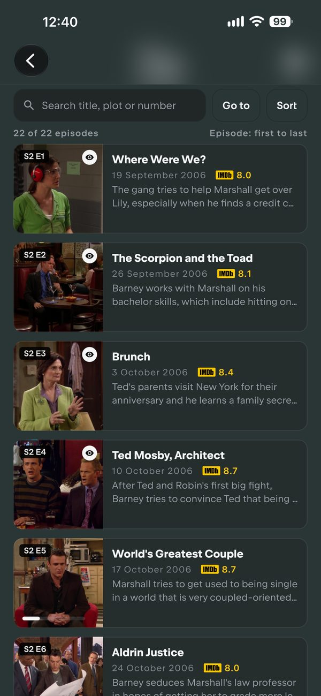
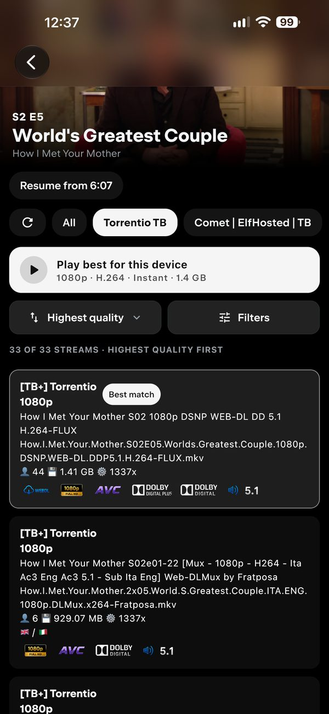
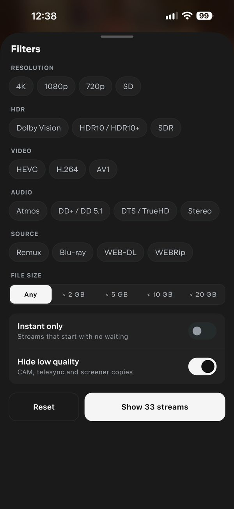
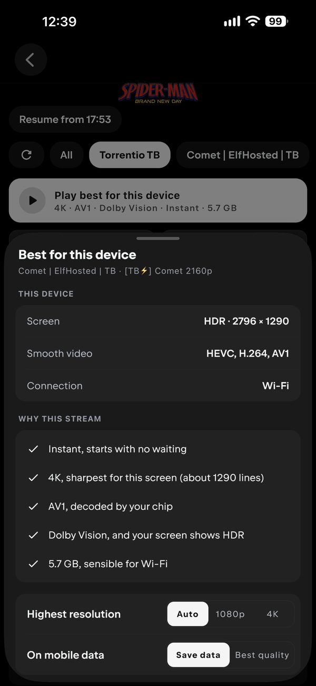
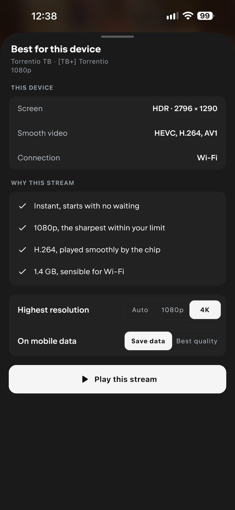

# Nuvio Enhanced (IMDb build)

A personal fork of [luqmanfadlli/NuvioMobile-Enhanced](https://github.com/luqmanfadlli/NuvioMobile-Enhanced), which is itself an unofficial fork of the official [NuvioMedia/NuvioMobile](https://github.com/NuvioMedia/NuvioMobile).

For features, Android builds, support and everything else, see the [original fork](https://github.com/luqmanfadlli/NuvioMobile-Enhanced).

Not affiliated with the Nuvio team or luqmanfadlli. Please don't report issues from this build to them.

## What's changed

- **IMDb-only episode ratings.** Episode cards show the IMDb rating (and your own rating) only. The TMDB badge is removed.
- **Bigger IMDb logo.** The IMDb logo on episodes is drawn wide (2:1), the same as the official Nuvio app, instead of squashed into a square.
- **Sort, Filters and "Play best for this device" on the streams page.** Sort by quality, size or speed; filter by resolution, HDR, video, audio, source and file size; or tap once to play the stream that suits your screen, chip and connection best (it explains why it picked it).
- **Automatic updates.** This fork regularly checks the original fork for a new release, merges it in with the changes above, builds the iOS app and publishes it.

Everything else is the same as the original fork.

## Screenshots

**IMDb episode ratings**



**Streams page: sort, filters and best for this device**

<table>
  <tr>
    <td></td>
    <td></td>
    <td></td>
    <td></td>
  </tr>
  <tr>
    <td align="center">Streams list</td>
    <td align="center">Filters</td>
    <td align="center">Best pick (4K)</td>
    <td align="center">Best pick (1080p limit)</td>
  </tr>
</table>

## Install (iOS)

Add this source in Feather (or AltStore / SideStore):

```
https://raw.githubusercontent.com/lalith14/NuvioMobile-Enhanced/feather-source/source.json
```

Or download the IPA from [Releases](https://github.com/lalith14/NuvioMobile-Enhanced/releases/latest).

The IPA is unsigned. To keep your data, sign it with the same certificate as your installed Nuvio and install it over the existing app.
