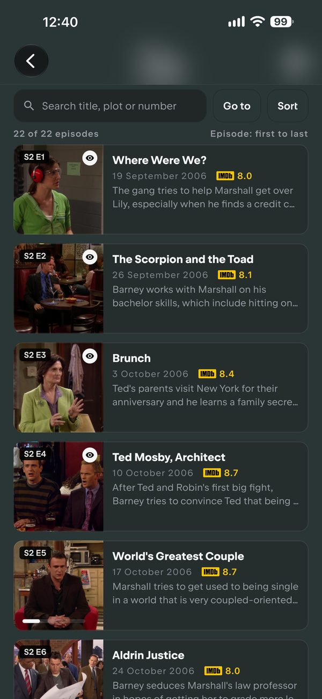
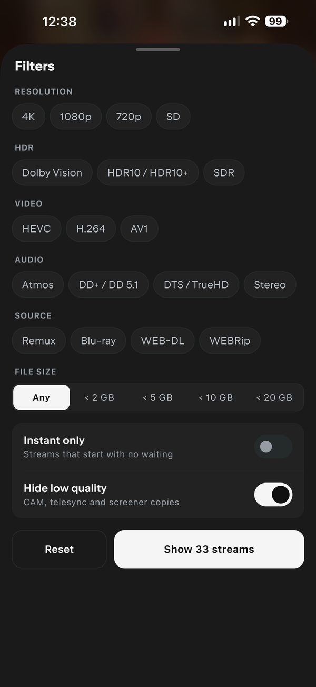
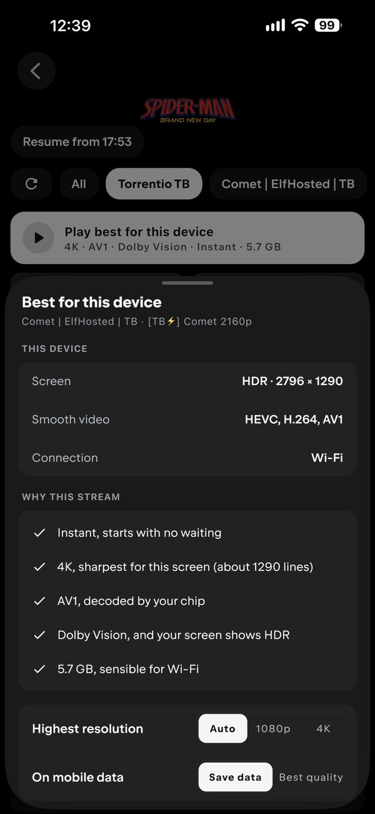
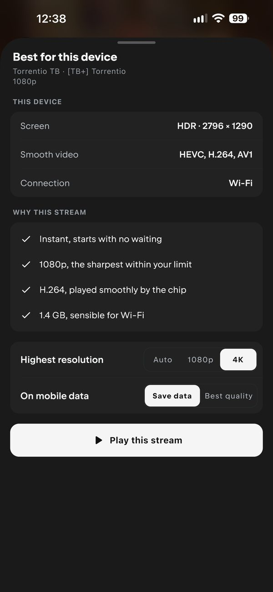

# Nuvio Enhanced (IMDb build)

A personal fork of [luqmanfadlli/NuvioMobile-Enhanced](https://github.com/luqmanfadlli/NuvioMobile-Enhanced), which is itself an unofficial fork of the official [NuvioMedia/NuvioMobile](https://github.com/NuvioMedia/NuvioMobile).

For features, Android builds, support and everything else, see the [original fork](https://github.com/luqmanfadlli/NuvioMobile-Enhanced).

Not affiliated with the Nuvio team or luqmanfadlli. Please don't report issues from this build to them.

## What's changed

**Ratings**
- **Real IMDb episode ratings.** Episode ratings come straight from IMDb's own free daily data, refreshed every day. No API key or account needed.
- **IMDb only.** Episode cards show the IMDb rating (and your own rating) only. The TMDB badge is removed, and episodes IMDb hasn't rated yet show no rating instead of a TMDB score.
- **Bigger IMDb logo.** The IMDb logo on episodes is drawn wide (2:1), the same as the official Nuvio app, instead of squashed into a square.
- **OMDb setting removed.** Ratings are automatic, so the OMDb API key setting is gone.

**Streams page**
- **Sort, Filters and "Play best for this device".** These started in this fork and are now part of the original fork too (thanks, Luqman). This build changes how "Play best" picks:
  - **Sized for your screen.** On a phone it aims for what the screen can actually show, so a movie comes out around 5–12 GB instead of a 30+ GB 4K remux. TVs and external displays still aim for full 4K.
  - **English-only first.** Files with no language listed count as English, and English-only files win over dual-language ones (like EN/IT) when the quality is about the same.
  - **Live connection.** The Wi-Fi / mobile data check updates while the page is open.
- **Works sideways too.** With the phone turned sideways (or on iPad), the streams page has the same Sort, Filters and "Play best for this device". The buttons scroll away with the list, so there's room to pick a stream.
- **Follows your background setting sideways.** With *Streams background* set to Normal, the sideways page is plain like the upright one. Only Cinematic gets the artwork and glass.

**Smoother and faster**
- **Smoothness mode** (Settings > Layout > Performance). Swaps the heavy live glass blur and the shadow under text for a lighter frosted look, so scrolling is smoother. Your glass settings are kept for when you turn it off.
- **Turns on by itself** when your iPhone is in Low Power Mode, has Reduce Transparency on, or gets warm.
- **Titles open faster.** Details start loading the moment you tap a poster, and the page shows that poster while it loads instead of a black screen.
- **Home loads ahead.** The rows just below the screen are prepared before you scroll to them (paused in Low Power Mode).
- **Press squish.** Posters, Continue Watching cards and episodes shrink slightly when you press them and spring back.
- **Quicker image fade.** Pictures fade in about twice as fast, so a fast scroll doesn't shimmer.

**Look**
- **No blurred strip at the top.** The frosted strip across the top of the show page, Streams and Settings pages is gone. The artwork runs sharp right up to the top of the screen, with just the back button over it.
- **Just the pill at the bottom.** With the Liquid Glass tab bar set to Static or Auto-hide, the blurred band behind the tab bar is gone, leaving only the floating pill.

Everything else is the same as the original fork.

## Screenshots

**Episode ratings: before and after**

<table>
  <tr>
    <td align="center"><b>Before</b> (IMDb + TMDB)</td>
    <td align="center"><b>After</b> (IMDb only, wide logo)</td>
  </tr>
  <tr>
    <td></td>
    <td></td>
  </tr>
</table>

**Top of the page: before and after**

<table>
  <tr>
    <td align="center"><b>Before</b> (blurred strip)</td>
    <td align="center"><b>After</b> (artwork to the top)</td>
  </tr>
  <tr>
    <td></td>
    <td></td>
  </tr>
</table>

**Streams page: sort, filters and best for this device**

<table>
  <tr>
    <td align="center">Streams list</td>
    <td align="center">Filters</td>
  </tr>
  <tr>
    <td></td>
    <td></td>
  </tr>
  <tr>
    <td align="center">Best pick (4K)</td>
    <td align="center">Best pick (1080p limit)</td>
  </tr>
  <tr>
    <td></td>
    <td></td>
  </tr>
</table>

## Install (iOS)

Add this source in Feather (or AltStore / SideStore):

```
https://raw.githubusercontent.com/lalith14/NuvioMobile-Enhanced/feather-source/source.json
```

Or download the IPA from [Releases](https://github.com/lalith14/NuvioMobile-Enhanced/releases/latest).

The IPA is unsigned. To keep your data, sign it with the same certificate as your installed Nuvio and install it over the existing app.
