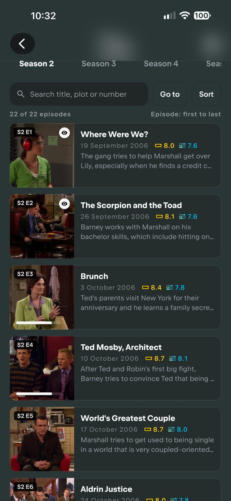
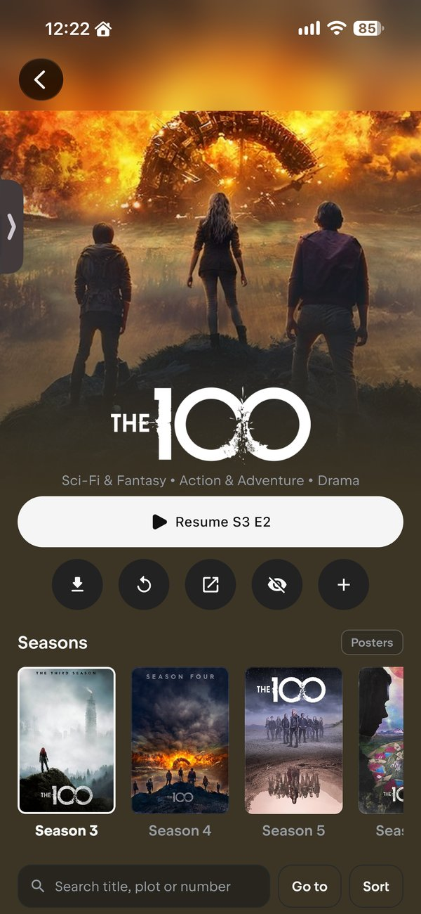
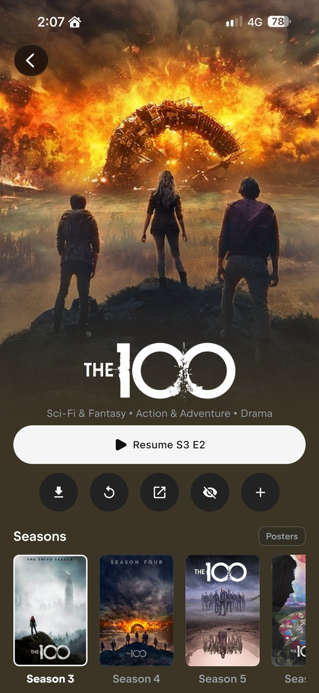
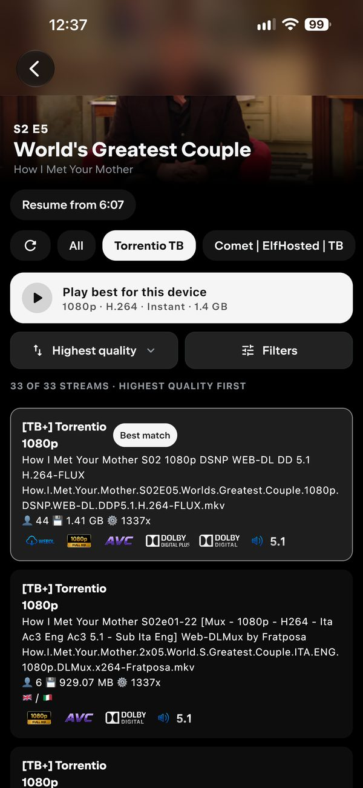

# Nuvio Enhanced (IMDb build)

A personal fork of [luqmanfadlli/NuvioMobile-Enhanced](https://github.com/luqmanfadlli/NuvioMobile-Enhanced), which is itself an unofficial fork of the official [NuvioMedia/NuvioMobile](https://github.com/NuvioMedia/NuvioMobile).

For features, Android builds, support and everything else, see the [original fork](https://github.com/luqmanfadlli/NuvioMobile-Enhanced).

Not affiliated with the Nuvio team or luqmanfadlli. Please don't report issues from this build to them.

## What's changed

**Ratings**
- **Real IMDb episode ratings.** Episode ratings come straight from IMDb's own free daily data, refreshed every day. No API key or account needed.
- **IMDb only.** Episode cards show the IMDb rating (and your own rating) only. The TMDB badge is removed, and episodes IMDb hasn't rated yet show no rating instead of a TMDB score.
- **Bigger IMDb logo.** The IMDb logo on episodes is drawn wide (2:1), the same as the official Nuvio app, instead of squashed into a square.
- **OMDb setting removed.** Ratings are automatic, so the OMDb API key setting is gone.

**Streams page**
- **Sort, Filters and "Play best for this device".** Sort by quality, size or speed; filter by resolution, HDR, video, audio, source and file size; or tap once to play the stream that suits your screen, chip and connection best (it explains why it picked it).
- **Works sideways too.** With the phone turned sideways (or on iPad), the streams page has the same Sort, Filters and "Play best for this device", using the same saved choices. The buttons scroll away with the list, so there's room to pick a stream.
- **Follows your background setting sideways.** With *Streams background* set to Normal, the sideways page is plain like the upright one, with no artwork and no glass panel. Only Cinematic gets the artwork and glass.

**Look**
- **No blurred strip at the top.** The frosted strip across the top of the show page, Streams and Settings pages is gone. The artwork runs sharp right up to the top of the screen, with just the back button over it.

Everything else is the same as the original fork.

## Screenshots

**Episode ratings: before and after**

<table>
  <tr>
    <td align="center"><b>Before</b> (IMDb + TMDB)</td>
    <td align="center"><b>After</b> (IMDb only, wide logo)</td>
  </tr>
  <tr>
    <td></td>
    <td></td>
  </tr>
</table>

**Top of the page: before and after**

<table>
  <tr>
    <td align="center"><b>Before</b> (blurred strip)</td>
    <td align="center"><b>After</b> (artwork to the top)</td>
  </tr>
  <tr>
    <td></td>
    <td></td>
  </tr>
</table>

**Streams page: sort, filters and best for this device**

<table>
  <tr>
    <td align="center">Streams list</td>
    <td align="center">Filters</td>
  </tr>
  <tr>
    <td></td>
    <td></td>
  </tr>
  <tr>
    <td align="center">Best pick (4K)</td>
    <td align="center">Best pick (1080p limit)</td>
  </tr>
  <tr>
    <td></td>
    <td></td>
  </tr>
</table>

## Install (iOS)

Add this source in Feather (or AltStore / SideStore):

```
https://raw.githubusercontent.com/lalith14/NuvioMobile-Enhanced/feather-source/source.json
```

Or download the IPA from [Releases](https://github.com/lalith14/NuvioMobile-Enhanced/releases/latest).

The IPA is unsigned. To keep your data, sign it with the same certificate as your installed Nuvio and install it over the existing app.
